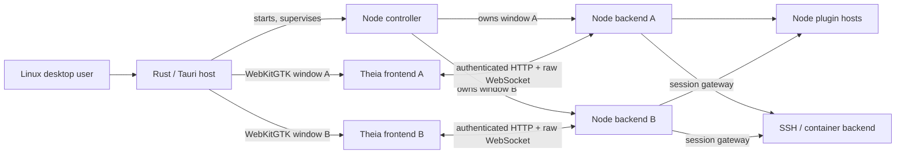

# Theia Tauri PoC

## Technical report

> **Finding:** The PoC demonstrates that an extensive Theia desktop workflow can run through a Tauri host on Linux. It supports Tauri as a credible *optional* desktop target. The evidence does not establish full Electron parity, production readiness, better runtime performance, or a stronger end-to-end security boundary.

The PoC branch, `tauri-int`, contains the Linux desktop integration and example packaging for both hosts. This report combines the candidate rationale, implementation results, package measurements, and limits in one place. A consolidated findings companion can carry the scenario-level evidence.

**Assessment:** preserve the Linux PoC as a reviewable implementation and consider an opt-in target where an adopter has a specific need. Keep Electron as the established desktop baseline while the deployment, security, compatibility, and operating-cost questions below remain open.

## 1. Question, scope, and evidence standard

The PoC tested whether Theia could gain a genuine Tauri desktop target while preserving its frontend, Node backend, and extension architecture. The scope covered a source-built Linux example and representative desktop workflows. Example packaging was added to make a first distribution comparison possible; installers, cross-platform delivery, exhaustive parity, and adoption remain separate decisions.

**Environment.** Most interactive checks ran on Ubuntu 24.04.5 with X11 under Xvfb and Metacity; a short real X11 session reached the workbench and checked window states. The integration used Rust 1.90.0, Tauri 2.11.6, WebKitGTK 2.52.6 and Node 24.21.0 for builds and validation. This host lacked standard WebKitGTK development headers/pkg-config files, so a temporary extracted development sysroot enabled Rust builds. A clean developer machine needs the documented Linux prerequisites. Windows, macOS, Wayland, extended real-display use, and clean-machine installation were not tested.

**How to read the evidence.** “Observed” means a named fixture or user workflow passed in the native Tauri example. “Matched” means a focused Electron scenario was also run with comparable source. Neither term means a whole feature family was exhaustively tested. “Inferred” marks a plausible benefit or cost drawn from the architecture. Package sizes measure four local files, not runtime resources. The consolidated findings companion can provide scenario steps, screenshots, and the detailed boundaries behind these summaries.

## 2. Why Tauri was selected for the experiment

The first step was a **candidate screen**, not a decision to replace Electron. The initial investigation examined the Theia/Electron architecture and a range of desktop hosts. It treated Theia's Node backend, extension hosts, native modules and web frontend as constraints. A promising alternative needed to host the real frontend and supervise compatible Node processes; a small shell around a reduced browser example would answer a different question. The investigation did not install or benchmark the candidates, and it explicitly left Theia startup, memory and package-size gains unproven.

| Candidate at the initial screen | Disposition then | Reason for its position |
| --- | --- | --- |
| **Tauri v2** | **Prototype first** | Documented Node sidecar route, native windows/menus/dialogs, distribution and update facilities, capability-based API boundary, and a system WebView that might remove bundled Chromium from the app payload. It offered the clearest *starting hypothesis* for retaining Theia's Node architecture. |
| **Neutralinojs** | Secondary lightweight-shell comparator | It could also retain Node and use a system WebView, but full-binary updates and multiwindow/backend coordination appeared to leave more product work to Theia or an adopter. |
| **Electrobun 2.x** | Conditional experiment | A system-WebView/CEF choice was interesting, but the reviewed target matrix, runtime/toolchain transition and upstream contribution policy were significant gates for Theia. |
| **Wails v3** | Watch or conditional secondary candidate | It offered a native Go shell, but the multiwindow line under consideration was beta and would add Go infrastructure around the retained Node application. |
| **NW.js** | Document, lower priority | Its Chromium-plus-Node model was credible, but retained the browser payload while still requiring host integration; no compensating Theia benefit had been demonstrated. |
| **Raw CEF, Qt WebEngine or minimal WebView libraries** | No first prototype | These would transfer more desktop lifecycle, bridge, packaging and update ownership to Theia; CEF and Qt WebEngine also retain Chromium. |

The preference for Tauri was **comparative and provisional**: among the screened hosts, it offered a practical way to test system-WebView distribution potential while retaining Theia's Node backend and using a mature set of desktop facilities. Its Rust toolchain, platform-specific engines, and native authority boundary were known costs. The candidate screen gave no evidence that Tauri would be faster, use less memory, or make the entire IDE safer.

**The first prototype changed the recommendation.** Small private Tauri and Electron apps both passed edit/save, terminal, Node-extension, and webview workflows; Tauri needed a disposable generated-asset patch for its webview. In three exploratory Linux/Xvfb launches per host, median visible Welcome was **8.46 s for Tauri versus 5.43 s for Electron**, and median process-tree PSS was **1,291,836 KiB versus 1,047,703 KiB**. Debug versus release host, unmatched Node patch versions, Xvfb, and non-isolated builds make those directional diagnostics, not release performance results. No self-contained distribution size was measured. The first prototype therefore supported retaining Electron and pausing broad validation unless a concrete product need justified it.

The subsequent source integration was a separate feasibility study. It examined whether the real contribution model, native lifecycle, extension webviews, and remote workflows could work in a Tauri target even though the first prototype had not shown a product benefit. The package measurements in this report are later evidence; they do not retroactively turn the original candidate choice into a measured performance or adoption decision.

## 3. What was built

The `tauri` target selects target-specific frontend, backend and controller contributions. An Electron-derived example uses the same Theia extension dependency inventory. A Rust native host starts a Node controller; the controller owns a separate backend, loopback port, token, cookie, and WebKit data directory for each workbench window. The frontend loads from its backend and uses an authenticated raw WebSocket service channel. Tauri JavaScript invoke capabilities are empty; named native services route through the authenticated controller/backend boundary. This is an explicit design choice that keeps the Tauri API surface narrow, but does not remove the authority of the Node backend or extension hosts.



The controller also handles second-instance forwarding, window lifecycle and native operations. The host's close request consults frontend vetoes and persists normal layout before destroying a WebKit window. Embedded extension pages and mini-browser content use isolated local origins and scoped resources. Remote sessions keep the workbench on its local origin and route authorized service/file traffic to a separate remote backend. This architecture is materially more than replacing Electron's window chrome with a WebView.

## 4. Verified coverage

| Area | Observed result | Evidence boundary |
| --- | --- | --- |
| **Target composition** | Target parsing, per-entry selection, generated bundles, Rust build and Electron-derived example; omitted Electron-only registrations are diagnosed. | The 33-entry first inventory was not closed as a complete same-revision scenario matrix. |
| **Host and windows** | Per-window authenticated backend, native bridge, menu/window commands, independent windows, second-instance forwarding, URL dispatch, normal close veto/layout restoration, focus recovery and selected process cleanup. | Named HTTP/WS/navigation probes passed; malformed protocol coverage, all startup/crash races, collision recovery and the full untrusted-content boundary remain open. |
| **Files and OS services** | Local native and remote Theia dialogs, Save As, workspace restoration, trash, system opening, external terminal, text clipboard, task diagnostics, permission feedback, internal Explorer moves, and Nautilus file/folder drops. | Focused X11 cases; direct row drops under Xvfb were unreliable; remote native drops use **Upload Files...**. Rich clipboard, large mixed drops and broader filesystem edge cases remain open. |
| **Plugins and embedded content** | Webview panel/view, custom editor, notebook renderer/preloads and kernel switch, mini-browser, VSIX/Open VSX install and manual version change, hosted/headless plugin paths, native addons, real Git SCM and Node debugging. | Selected probes and extensions only; arbitrary extensions, complex notebooks, external services and full embedded-content authority are unproven. |
| **Remote and containers** | Authenticated SSH and Docker sessions covered editor, terminal, tasks, extension webviews, preview, transfer, icons, port forwarding, reconnect, failure return and unsaved-work veto. A simple devcontainer was created; 8 MiB upload/download matched hashes. | Short, disposable sessions and a small config set; remote task diagnostics, more HTTP surfaces, load cancellation, OAuth and long sessions remain open. |
| **Developer workflow** | Clean example build, launch from another directory, target switching, Ctrl-C cleanup, named tests, and serialized native-addon preparation. | Rust host edits still require manual rebuild/restart in `watch:tauri`; an interrupted native-preparation lock may need manual recovery. |
| **Evaluation evidence** | The native workflow checks, focused Electron references, this report, and the companion consolidated findings make the PoC reviewable. | No complete parity matrix, product support assessment, long real-display session or cross-platform release evidence. |

Concrete matched scenarios include a Git extension staging a file, a Node debugger pausing on the same source line, local task problem markers, dirty-save permission recovery, Explorer moves, and a focused remote container editor/terminal/reconnect cycle. The same example did **not** bundle those VSIXs by default; their checks installed disposable extension copies. A native AT-SPI probe exposed menu items and editor text, and one IBus Wubi session showed preedit, commit and cancel. Those are useful focused signals, not screen-reader or broad IME parity.

The consolidated findings companion can retain selected captures alongside the steps and boundaries for each check. A screenshot supports its named scenario, not an entire feature family.

## 5. Where the port exposed real differences

| Difference | PoC response | What it implies |
| --- | --- | --- |
| WebKitGTK's Socket.IO path stalled during repeated startup. | Tauri uses a raw `/tauri-services` WebSocket; browser and Electron retain their existing transports. | Transport compatibility needs target-specific coverage. |
| WebKit clipboard permission checks failed for text read/write. | An authenticated native bridge reaches the GTK clipboard; X11 text round trips with `xclip` passed. | Rich MIME types and post-exit ownership still need design/testing. |
| Webview and preview origins cannot simply share trusted backend authority. | Scoped `*.webview.localhost` and `*.mini-browser.localhost` endpoints, explicit grants and origin/cookie checks; named escape and WS probes denied access. | Audit must include every embedded-content and native route, especially untrusted extensions. |
| Native close did not emit the browser unload event used to save layout. | Frontend veto and an explicit unload hook run before host destruction. | Lifecycle semantics must be owned deliberately across host and backend. |
| GTK external file drops did not arrive through HTML `DataTransfer`. | A window-scoped native drop handoff and one-time backend copy support local files/folders. | More file managers, Wayland, row targets and remote drops are still unverified. |
| Remote workbench and resources span distinct backends. | A local authenticated session gateway carries services and file transfers; isolated preview grants serve remote content. | Session ownership and cross-window isolation are core review surfaces. |
| Electron and standalone Node native addons need different preparation. | A shared atomic lock serializes rebuild/restore; target switching and addon loads passed. | Third-target development and release builds add ABI and CI work. |

Several fixes improved shared Theia behavior: task problem markers clear on rerun/background cycles, and save failures now surface while retaining dirty editor content. Those were verified in focused Tauri and Electron runs. The changes illustrate what an alternative host can uncover; they do not establish that the long-term upkeep will be low.

## 6. Linux package experiment

The PoC includes packaging scripts and configuration for both example targets. Production builds produced an unpacked directory, portable `.tar.gz`, and `.deb` for Linux amd64. Tauri includes the release Rust host, a Node 24 executable, native addons, and application assets; it relies on the system WebKitGTK runtime. Electron includes its Chromium/Node runtime and the corresponding example assets. Both commands check native-addon loading while staging. Package contents, launchers, desktop entries, dependencies, and the Electron `chrome-sandbox` mode were inspected. These are unsigned examples, separate from Theia IDE product releases. Packaged GUI smoke did **not** complete in the test environment: Tauri's local Unix socket and Electron's Chromium sandbox hit `EPERM`. This must be rechecked on an ordinary host before making a deployability claim.

| Local artifact | Tauri | Electron | Tauri reduction |
| --- | ---: | ---: | ---: |
| Portable `.tar.gz` | 98,694,592 B (94.1 MiB) | 168,048,653 B (160.3 MiB) | 41.3% |
| Debian `.deb` | 71,493,814 B (68.2 MiB) | 120,414,484 B (114.8 MiB) | 40.6% |

These figures compare the same example inventory and an **empty packaged plugin directory**. They show smaller *package files* in this local build, not smaller installed disk use, total dependencies, update downloads, memory, CPU, startup time, or user-visible speed. System WebKitGTK is outside the Tauri archive. The branded Theia IDE product and its extension set are different from these examples.

## 7. Electron and Tauri: implications for Theia

| Dimension | Electron baseline | Tauri PoC and consequence |
| --- | --- | --- |
| **Browser engine** | Bundled Chromium gives Theia a defined desktop engine version. | Tauri uses WebKitGTK on Linux, WKWebView on macOS and WebView2 on Windows. The Linux repairs above show real engine variance; other OSs were not implemented. [Tauri WebView versions](https://v2.tauri.app/reference/webview-versions/). |
| **Runtime/distribution** | Electron brings its browser/Node runtime into the app. | The Rust host can omit bundled Chromium, but this Theia architecture still bundles Node and needs system WebKitGTK. Example files are ~41% smaller here; no whole-product resource result follows. [Electron process model](https://www.electronjs.org/docs/latest/tutorial/process-model); [Tauri architecture](https://v2.tauri.app/concept/architecture/). |
| **Native authority** | Electron offers mature native APIs; isolation, sender validation and preload design remain application duties. | The PoC uses empty Tauri invoke capabilities and named authenticated routes. This is easier to enumerate, but the Node backend, plugin hosts and embedded content remain privileged surfaces. Linux iframe distinction in Tauri capability checks is a particular review concern. [Electron security](https://www.electronjs.org/docs/latest/tutorial/security); [Tauri capabilities](https://v2.tauri.app/security/capabilities/). |
| **Extension and remote workflow** | Existing Theia target and product experience. | Selected extensions, webviews, native addons, SSH and containers work; arbitrary extension compatibility and long sessions are not established. |
| **Maintenance** | Current Theia desktop path has established tooling and release practice. | The PoC touches 193 files (+13,466/−180 lines from base, including tests/docs), adds Rust/WebKit/Node boundaries and another native test matrix. These counts show breadth, not yearly cost. |

The most credible benefit is **choice for downstream products** with a reason to prefer a system WebView or Rust host, supported by a demonstrated Linux integration. Smaller shipped example archives and a more explicit native call surface are promising, narrower findings. There is no evidence yet to claim a generally lighter, faster, safer, or easier-to-maintain Theia desktop application. [Theia's frontend/backend architecture](https://theia-ide.org/docs/architecture/) explains why an alternate host was feasible at all.

## 8. Remaining decision gates

| Gate | Evidence needed next | Why it matters |
| --- | --- | --- |
| **Deployable Linux package** | Review packaging source; launch both installed and portable builds on ordinary clean Linux hosts; test WebKit dependencies, Node/native ABI, install, upgrade, uninstall and sandbox behavior. | Present packages were structurally checked but GUI smoke was blocked in the previous environment. |
| **Matched value** | Same revision, profiles and plugin set in release builds; compressed full/update size, installed size, cold/warm startup, idle/active memory, CPU and responsiveness. Set a worthwhile threshold before collecting results. | The ~41% archive delta cannot answer user experience or support economics. |
| **Security boundary** | Threat-model HTTP/WS/native/remote paths; test hostile pages/extensions, origin and cookie spoofing, token replay, window/session mix-ups, native drop/upload and update/install routes. | Named negative probes are not a complete authority proof. |
| **Compatibility and access** | Prioritized Electron/Tauri workflow matrix, long real-display sessions, popular extensions, richer filesystem/input cases, Wayland/scaling, keyboard and screen-reader journeys, multiple IMEs. | Focused passes do not establish broad desktop support. |
| **Second OS and ownership** | A Windows or macOS prototype plus maintainers for Rust, engine-specific regressions, Node ABI, CI, signing, updates and release response. | Tauri's engine and OS differences are a continuing product cost. |

If a downstream adopter can name a distribution or host requirement that matters enough to fund these gates, the next useful experiment is to finish the Linux package smoke and matched measurement, then test one second OS. If no such requirement exists, the PoC already delivers the requested feasibility evidence: retain it as a reference without implying a support commitment.

## 9. Reproduction and evidence

Build the examples from a Theia checkout with Node 24, Rust, and the Tauri Linux development prerequisites. Build and package one target before switching to the other because native-module preparation shares a cache.

```sh
npm install
npm run compile
npm run build:tauri:production
npm run package:tauri
npm run build:electron:production
npm run package:electron
```

The package commands write unpacked applications, portable archives, and Debian packages under `dist/desktop/`. The measurements above come from the local Linux amd64 archives and Debian packages. They do not establish that the packaged GUI launches on a clean host.

The consolidated findings companion should retain the scenario steps, observed results, captures, and unresolved coverage behind this synthesis. This report carries the interpretation and decision gates.
